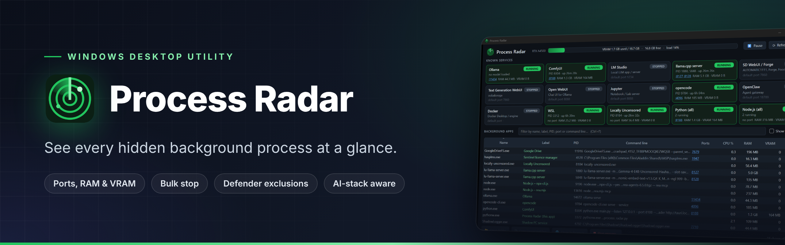
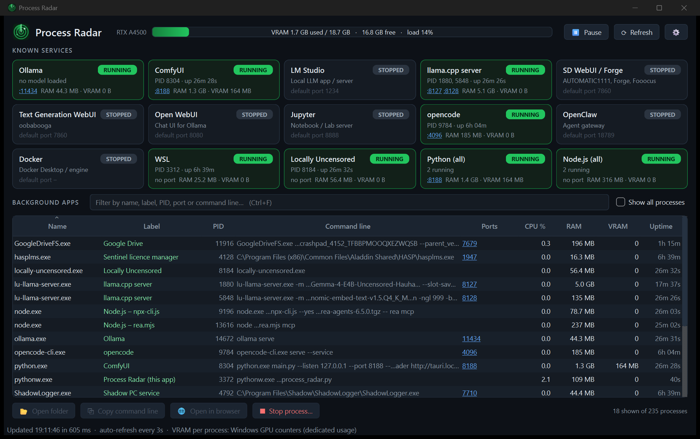
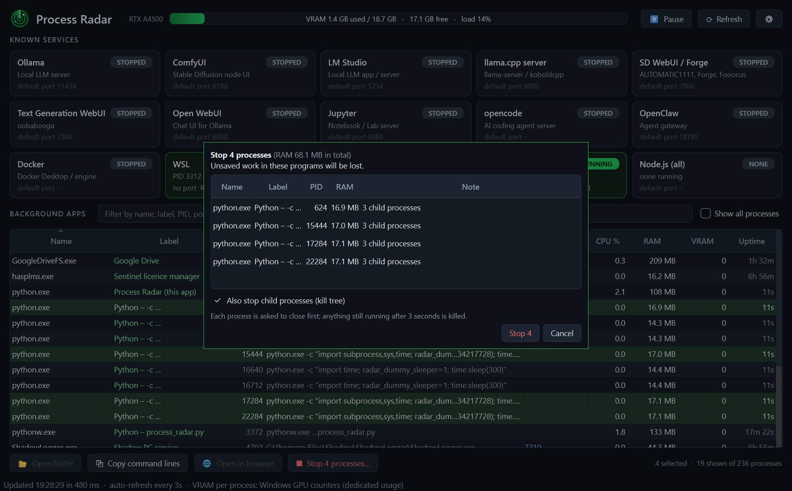
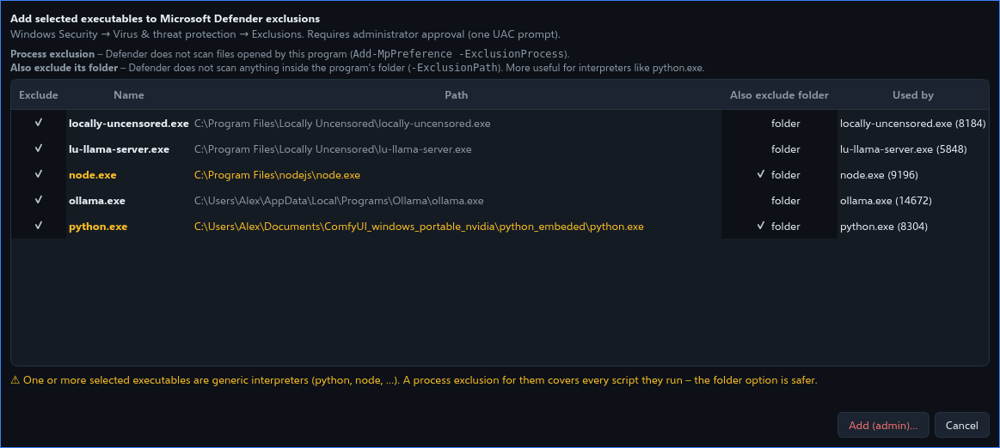

<p align="center">
  
</p>

<p align="center">
  
  
  
  
  
</p>

<h3 align="center">Is Ollama still running? Is ComfyUI eating your VRAM? Process Radar shows every windowless background app — with ports, CPU, RAM, VRAM and uptime — and lets you stop them in bulk.</h3>

<p align="center">
  <a href="#-quick-start">Quick start</a> ·
  <a href="#-features">Features</a> ·
  <a href="#%EF%B8%8F-hotkeys">Hotkeys</a> ·
  <a href="#-configuration">Configuration</a> ·
  <a href="#-faq--troubleshooting">FAQ</a> ·
  <a href="#-roadmap">Roadmap</a> ·
  <a href="#-pro--coming-soon">Pro</a>
</p>

---

## ✨ Features

<table>
<tr>
<td width="33%" valign="top">

### 🟢 Known-service cards
Instant RUNNING / STOPPED status for **Ollama, ComfyUI, LM Studio, llama.cpp, SD WebUI / Forge, Text Generation WebUI, Open WebUI, Jupyter, Docker, WSL** and more — including loaded Ollama models.

</td>
<td width="33%" valign="top">

### 🔍 Background apps, demystified
Every process that listens on a port, is a Python / Node / Java runtime, or runs without a window — with friendly labels like *ComfyUI* or *Python – main.py*.

</td>
<td width="33%" valign="top">

### 🎮 VRAM per process
GPU bar plus per-process dedicated VRAM — even in WDDM mode, where `nvidia-smi` reports `[N/A]`, via Windows GPU performance counters.

</td>
</tr>
<tr>
<td valign="top">

### 🧹 Bulk stop
Ctrl+click, Shift+click or Ctrl+A, then **Stop N processes…** — one confirmation, optional kill-tree, and a per-PID result summary.

</td>
<td valign="top">

### 🛡️ Defender exclusions
Add selected programs (or their folders) to Microsoft Defender exclusions with one UAC prompt — full paths filled in for you, with warnings for generic interpreters.

</td>
<td valign="top">

### 🌐 Clickable ports
Open `http://localhost:<port>` straight from the list or a service card.

</td>
</tr>
<tr>
<td valign="top">

### ⚠️ Safety rails
Windows-system processes are flagged in red and Process Radar never stops itself. Each process gets a graceful close before a forced kill.

</td>
<td valign="top">

### ⌨️ Summon anywhere
**Ctrl+Alt+P** shows / hides the window. Lives in the tray; a second launch just focuses the open window.

</td>
<td valign="top">

### 🧾 CLI report
`--report` prints a text snapshot of services and background apps — perfect for scripts and support tickets.

</td>
</tr>
</table>

## 📸 Screenshots

<p align="center"></p>

<table>
<tr>
<td align="center" width="50%"><br><sub>Bulk stop with one confirmation (demo dummy processes)</sub></td>
<td align="center" width="50%"><br><sub>Defender exclusions with full paths (demo data)</sub></td>
</tr>
</table>

## 🚀 Quick start

**Requirements:** Windows 10/11 and Python 3.11+ with the `py` launcher (`winget install Python.Python.3.12`). An NVIDIA GPU is optional (for the VRAM view).

1. **Download** or clone this repository.
2. **Double-click `install.bat`.** It installs PySide6-Essentials and psutil for your user and adds a **Process Radar** Start Menu shortcut.
3. **Start it** from the Start Menu or with **`run.bat`** — it finds a Python with the right packages, starts without a console, and shows a clear message box if something is missing.
4. Press **Ctrl+Alt+P** any time to bring it up.

Prefer to do it by hand? `py -m pip install --user -r requirements.txt`, then `run.bat`.
Extra shortcuts: `shortcut.ps1 -Folder Desktop` or `shortcut.ps1 -Dir "D:\Some Folder"`.

## ⌨️ Hotkeys

| Action | Shortcut |
|---|---|
| Show / hide Process Radar (global) | **Ctrl+Alt+P** (change under ⚙ Settings) |
| Filter the list | **Ctrl+F** |
| Refresh now | **F5** |
| Select multiple rows | **Ctrl+click** · **Shift+click** · **Ctrl+A** |
| Stop selected processes | **Delete** |
| Stop a whole service | **Ctrl+click** its card |

## 🛠 Configuration

**⚙ Settings** in the window or the tray menu:

| Setting | Notes |
|---|---|
| Global hotkey | Default Ctrl+Alt+P |
| Refresh interval | Default every 3 s; nothing is measured while the window is hidden |
| Show all processes | Include Windows system processes and normal windowed apps |
| Sort column, window position | Remembered automatically |
| 🛡 Manage exclusions… | View and remove current Defender exclusions (admin) |

**Command line**

```
python process_radar.py --report              text snapshot of services + background apps
python process_radar.py --report --all        include every process
python process_radar.py --screenshot out.png  save a picture of the window after the first refresh
```

**Files** — all per user:

| Path | Contents |
|---|---|
| `%APPDATA%\ProcessRadar\settings.json` | Settings and window position |
| `%APPDATA%\ProcessRadar\radar.log` | Log file (also written by `run.bat`) |

## ❓ FAQ & troubleshooting

<details>
<summary><b>Ctrl+Alt+P types "ö" / AltGr behaves oddly</b></summary>

Windows treats **AltGr as Ctrl+Alt**, so on US-International and similar layouts a global Ctrl+Alt+P also catches **AltGr+P** (normally *ö*). If you type that character, pick another combination in ⚙ Settings — for example Ctrl+Alt+Shift+P or Win+Alt+P.
</details>

<details>
<summary><b>The VRAM column shows 0 for everything</b></summary>

Per-process VRAM needs an NVIDIA GPU. If a process really uses no dedicated GPU memory (e.g. an LLM server running on the CPU), 0 is correct — which is a handy way to spot models that are not using your GPU. The status bar shows which data source is used.
</details>

<details>
<summary><b>"Access denied" when stopping a process</b></summary>

That process runs as administrator or SYSTEM. Start Process Radar as administrator, or stop the service the usual way.
</details>

<details>
<summary><b>Is adding Defender exclusions safe?</b></summary>

Exclusions reduce protection, so Process Radar makes every step explicit: you see the full path, generic interpreters (python, node, powershell…) get a warning, and nothing changes until you approve the single UAC prompt. Tamper Protection, group policy or third-party antivirus are reported in the result summary.
</details>

<details>
<summary><b>Nothing happens when I start it</b></summary>

`run.bat` shows a message box listing every Python it tried and writes the reason to `%APPDATA%\ProcessRadar\radar.log`. Usually `py -m pip install --user psutil PySide6-Essentials` fixes it.
</details>

<details>
<summary><b>How do I uninstall?</b></summary>

Run `uninstall.bat` (removes the Start Menu, Startup and Desktop shortcuts), then delete the app folder and `%APPDATA%\ProcessRadar`.
</details>

## 🗺 Roadmap

- [ ] Custom service definitions (your own name + port + command-line match)
- [ ] History graphs for CPU / RAM / VRAM
- [ ] Notifications when a service starts or stops
- [ ] AMD and Intel GPU support
- [ ] Signed single-file installer (no Python required)
- [ ] Auto-update

## 💎 Pro — coming soon

> **Not available yet.** A Pro edition is being planned. Pricing and release date will be announced later.

Candidate Pro features: custom service definitions, history graphs, start/stop alerts, multi-GPU vendors, a signed one-click installer and priority support. Interested? Watch this repository for updates.

## 📄 License

Proprietary software — **Copyright (c) 2026 GaryHman. All rights reserved.** See [LICENSE](LICENSE).

<sub>All product names are trademarks of their respective owners. This project is not affiliated with Microsoft, NVIDIA or any listed service.</sub>
